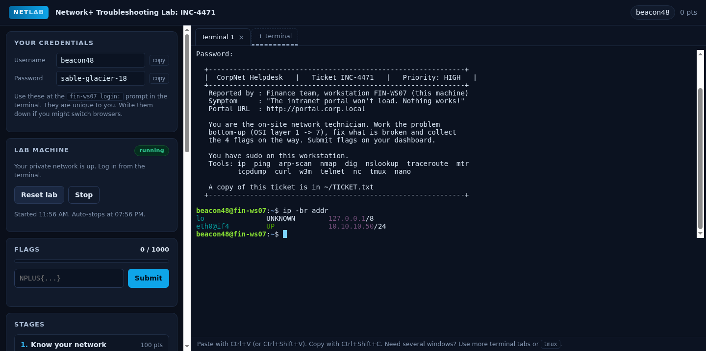

# Network+ Lab 01: Portal outage (INC-4471)

The first lab in the Network+ series of [ctf-challenges](../../README.md). A hands-on, CTF-style lab for CompTIA Network+ classes. Each student gets their own small corporate network and a broken workstation. Their job is to work a helpdesk ticket ("the intranet portal won't load") from the bottom of the OSI model up, fix each fault, and collect four flags.

Everything runs in the browser. Students open one URL, click **Claim credentials** and **Launch lab**, and get a Linux terminal on their own workstation. Nothing to install on student machines.



## What students work through

| Stage | Points | Skills |
|---|---|---|
| 1. Know your network | 100 | IP configuration, ARP, host discovery, known-good baseline |
| 2. Fix the IP configuration | 200 | Default gateway, DNS resolver, DNS record types |
| 3. Something is in the path | 300 | Layer 4 testing, insecure protocols, packet capture |
| 4. Fix the root cause | 400 | Router ACLs, change control, verification |

Flags are unique per student, so a flag copied from a neighbour is rejected. Each stage has three hints that students open one at a time.

Workstation tools: `ip`, `ping`, `arp-scan`, `nmap`, `dig`, `nslookup`, `traceroute`, `mtr`, `tcpdump`, `curl`, `w3m`, `telnet`, `nc`, `tmux`, `nano`, with `sudo`.

## Quick start

You need Docker with Docker Compose v2.

```bash
git clone https://github.com/kianoosh21/ctf-challenges.git
cd ctf-challenges/network-plus/lab01-portal-outage
docker compose up -d --build
docker compose logs netlab
```

The first build takes a few minutes. The log then prints the URLs and the instructor key:

```
NetLab is up.
  Students:        http://<this-machine>:8080/dashboard  or  https://<this-machine>:8443/dashboard
  Instructor view: http://<this-machine>:8080/dashboard/admin
  Instructor key:  8hT3qLw2Vx9mKc4RzP7nYb1F  (saved in the data volume)
  TLS certificate: self-signed (browsers show a warning once)
```

On the same computer, open <http://localhost:8080/dashboard>.

## Requirements

| | |
|---|---|
| Host | Linux with Docker Engine and Compose v2. Tested on Debian 13 with Docker 26.1 and Compose 2.26. |
| Docker Desktop | Windows and macOS should work, because the lab runs inside Docker's Linux VM, but this has not been tested. |
| Not supported | Rootless Docker and Podman. The lab needs a privileged container (see [Security](#security)). |
| CPU | x86_64 or arm64 |
| RAM | About 40 MB for the lab server plus about 20 MB per active student. See [Capacity](#capacity). |
| Disk | About 400 MB for the two images |

## Running a class

1. Start the lab on a machine your students can reach: a classroom PC, a VM, or a cloud server.
2. Give students the URL with that machine's IP address:
   - `https://<ip>:8443/dashboard`: encrypted, but the browser warns once about the self-signed certificate. Students click "Advanced" and continue.
   - `http://<ip>:8080/dashboard`: no warning, no encryption. Fine on a classroom LAN.
   - For a trusted certificate with no warning, see [Real HTTPS certificate](#real-https-certificate-on-a-cloud-server).
3. Each student clicks **Claim credentials**, then **Launch lab**, then logs in at the `fin-ws07 login:` prompt in the browser terminal with the username and password shown on the left.
4. Open `/dashboard/admin` and sign in with the instructor key.

Credentials are tied to the browser session (a cookie), not the IP address, so a whole classroom behind one NAT works. A student who changes browser uses **Sign in** with the same username and password.

The instructor view shows:

| Column or button | What it does |
|---|---|
| Student, Password | Every claimed account. Use it when a student loses their credentials. |
| Flags, Points | Progress per student |
| Machine, Terms, Last seen | Lab state, open terminals, last activity |
| +60 min, Reset, Stop | Give one student's lab more time, rebuild it, or stop it. Solved flags are kept. |
| Close claims | Stop new accounts being created once everyone has one |
| Stop all lab machines | Free the server at the end of the class |

Lab machines stop by themselves after 60 minutes unless the student extends them. See [Lab timer](#lab-timer).

## Lab timer

Every lab machine stops 60 minutes after launch (`LAB_MINUTES`), so labs that students walk away from stop using memory and CPU.

- The dashboard shows when the lab stops and how many minutes are left, and warns at 10 and 2 minutes.
- In the last 15 minutes an **Extend** button gives another 60 minutes from that moment. Only a student who is still at the dashboard can click it, so abandoned labs always stop.
- When time runs out, the lab machine is removed. Solved stages are kept, and **Launch lab** starts a fresh one.
- The instructor view shows the minutes left for each lab and has a **+60 min** button per student.

## Running several labs on one host

Each lab in this repo has its own default ports, images and data volume, so several can run on the same machine at once. This lab uses ports 8080 and 8443. Only one lab can use ports 80 and 443. To give several labs a trusted certificate, get one with certbot (or any ACME client) and point every lab at the same files with `TLS_CERT` and `TLS_KEY`. Renewed files are picked up within 10 minutes, no restart needed.

## Real HTTPS certificate on a cloud server

On a server with a public IP address or DNS name, the lab can get a free Let's Encrypt certificate by itself. Create `.env` next to `docker-compose.yml`:

```bash
HTTP_PORT=80
HTTPS_PORT=443
PUBLIC_HOST=203.0.113.10      # your server's public IP, or a DNS name that points to it
```

Then run `docker compose up -d`. Ports 80 and 443 must be open in the server's firewall or cloud security group. Plain HTTP then redirects to HTTPS.

- An IP address gets a short-lived certificate (about 6 days, a Let's Encrypt rule for IP certificates). The lab renews it by itself.
- A DNS name gets a normal 90-day certificate, also renewed by itself.
- To try the setup without using up Let's Encrypt rate limits, add `ACME_STAGING=1` first. Staging certificates are not trusted by browsers.
- Until the certificate arrives (about 10 seconds in testing), the lab serves its self-signed one. Problems show in `docker compose logs netlab`.

To use a certificate you already have instead, put `cert.pem` and `key.pem` in `./certs`, uncomment the `./certs` volume line in `docker-compose.yml`, and set `TLS_CERT=/certs/cert.pem` and `TLS_KEY=/certs/key.pem` in `.env`.

## Configuration

All settings are optional. Copy `.env.example` to `.env` and edit it, then run `docker compose up -d`.

| Setting | Default | Meaning |
|---|---|---|
| `HTTP_PORT` | `8080` | Port for plain HTTP on the host |
| `HTTPS_PORT` | `8443` | Port for HTTPS on the host |
| `ADMIN_KEY` | generated | Instructor key. If empty, one is generated on first start and kept. |
| `MAX_LABS` | `30` | Most lab machines running at once |
| `LAB_MINUTES` | `60` | Minutes before a lab machine stops by itself (see [Lab timer](#lab-timer)) |
| `LAB_EXTEND` | `1` | `0` hides the student Extend button. The instructor view can always extend. |
| `PUBLIC_HOST` | empty | Public IP or DNS name. Turns on Let's Encrypt. |
| `ACME_STAGING` | `0` | `1` uses the Let's Encrypt staging server for testing |
| `TLS_CERT`, `TLS_KEY` | empty | Paths inside the container to your own certificate and key |
| `TRUST_PROXY` | `0` | `1` only behind a reverse proxy that sets `X-Forwarded-For` and `X-Forwarded-Proto` |

The lab also refuses new launches when the host runs low on memory, so a full class cannot crash the server.

## Everyday commands

Run these in the `network-plus/lab01-portal-outage` folder.

| Task | Command |
|---|---|
| Start, or apply `.env` changes | `docker compose up -d` |
| Show URLs, instructor key and errors | `docker compose logs netlab` |
| Print only the instructor key | `docker compose exec netlab cat /var/lib/netlab/admin.key` |
| Stop everything (keeps students and scores) | `docker compose down` |
| Wipe everything: students, scores, key, certificates | `docker compose down -v` |
| Update to the latest version | `git pull && docker compose up -d --build` |

Stopping or restarting the lab server removes all running lab machines. Students see a message and click **Launch lab** again. Their accounts and solved flags are kept in the `netlab-data` volume.

## Capacity

Measured on a 1 vCPU / 1 GB RAM cloud server with 2 GB swap:

| Load | Result |
|---|---|
| Lab server with no labs running | about 35 MB RAM |
| One lab running, nobody logged in | about 5 MB RAM more |
| 14 labs running, 12 students logged in and scanning at the same time | about 330 MB RAM still free, everything responsive |
| Per active student | about 18 MB RAM |

A 1 GB server is comfortable for 15 to 20 students. For a bigger class, give the server more RAM and raise `MAX_LABS`. Each workstation container is limited to 192 MB RAM, half a CPU and 200 processes, so one student cannot starve the others.

## How it works

```
 Browser ──HTTP(S) + WebSocket──> netlab container (Python, aiohttp)
                                  │  dashboard, flags, scoreboard, instructor view (SQLite)
                                  │  browser terminal -> SSH into the student's workstation
                                  │
                                  ├─ per student, fully isolated:
                                  │    switch    Linux bridge in its own network namespace
                                  │    RTR-01    namespace + IOS-style telnet CLI, ACLs compiled to iptables
                                  │    PRN-01    namespace + printer web page
                                  │    ADMIN-PC  namespace, logs in to the router every ~30 s
                                  │    DNS01     namespace + dnsmasq
                                  │    PORTAL    namespace + intranet web page
                                  │
                                  └─ docker run ─> FIN-WS07 workstation container (one per student)
```

- Only the student workstation is a container. The other devices are network namespaces whose services run inside the controller, which keeps memory use low.
- Every student gets the same IP addresses (10.10.10.0/24 and 172.16.20.0/24) inside their own namespaces, so labs never collide.
- The router CLI accepts common IOS commands and abbreviations. ACL changes become real iptables rules in the router's namespace, so a student's fix (or mistake) changes real traffic.
- Workstations have no route to the internet, the host or other students.

## Security

- The `netlab` container is privileged, shares the host's process namespace and has the Docker socket. That is what lets it build networks and start workstation containers, and it means the container is effectively root on the host. Run the lab on a machine or VM used for teaching, not next to anything important.
- Students have `sudo` inside their own workstation container only. Docker's default seccomp profile applies, plus the `NET_ADMIN` capability so they can change routes and capture packets.
- Session and admin cookies are `HttpOnly` and `SameSite`, and are marked `Secure` over HTTPS. State-changing requests require a custom header and a same-origin check. Claims, sign-ins and flag submissions are rate limited.
- The dashboard is built for a class session. Close claims once everyone has credentials, and stop the lab after the class if it is on the internet.

## Troubleshooting

| Problem | Fix |
|---|---|
| `bind: address already in use` on start | Another program uses port 8080 or 8443. Set `HTTP_PORT` and `HTTPS_PORT` in `.env`. |
| Launch says the workstation image is missing | Run `docker compose build`, then `docker compose up -d`. |
| Launch fails with a `pid: host` message | The container was started without `pid: host` or `privileged: true`. Use the provided `docker-compose.yml`. |
| Other computers cannot open the page | Use the host's LAN IP, not `localhost`. Allow the ports in the host firewall or cloud security group. |
| Browser warns about the certificate | Expected with the self-signed certificate. Use plain HTTP on a LAN, or set `PUBLIC_HOST` for a real certificate. |
| Let's Encrypt keeps failing | Port 80 on `PUBLIC_HOST` must reach this container (`HTTP_PORT=80`). The log shows the exact error; the lab retries every hour. |
| Lost the instructor key | `docker compose exec netlab cat /var/lib/netlab/admin.key` |
| Workstation containers left over after a crash | They are removed on the next start. To remove them by hand: `docker rm -f $(docker ps -aq --filter label=netlab.instance=nplus-lab01)` |
| `workstation-image` shows as exited | Expected. It only builds the workstation image and exits. |

## Files

| Path | Contents |
|---|---|
| `docker-compose.yml` | The two services and the data volume |
| `Dockerfile` | Lab controller image |
| `app/app.py` | Web server, dashboard API, browser terminal, instructor view |
| `app/lab.py` | Builds and tears down each student's network |
| `app/rtrcli.py` | Router CLI and the ACL-to-iptables compiler |
| `app/content.py` | Ticket text, stages and hints |
| `app/certs.py` | Self-signed and Let's Encrypt certificates |
| `app/static/` | Dashboard and instructor pages |
| `workstation/` | Student workstation image (Debian with network tools) |
| `SOLUTION.md` | Instructor walkthrough with the full solution |

## Solution

[SOLUTION.md](SOLUTION.md) has the step-by-step solution, alternative fixes, discussion questions and instructor notes. It is a spoiler, so keep it away from students until after the lab.
