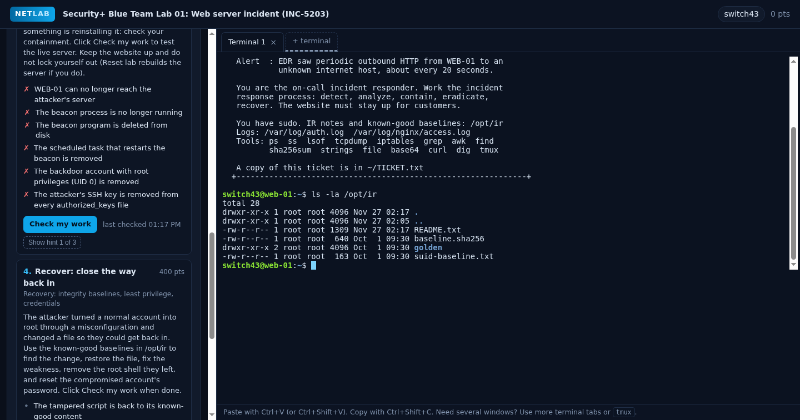

# Security+ Blue Team Lab 01: Web server incident (INC-5203)

The first blue team lab in the Security+ series of [ctf-challenges](../../../README.md). Students are the on-call incident responder for a compromised public web server. They follow the CompTIA incident response process on a live Linux server: detect the attacker's beacon, analyze the logs to find how they got in, contain the threat, eradicate the persistence, and recover the server without taking the website down.

Everything runs in the browser. Students open one URL, click **Claim credentials** and **Launch lab**, and get a terminal on their own copy of the compromised server. Nothing to install on student machines.



## What students work through

| Stage | Points | Scored by | Skills |
|---|---|---|---|
| 1. Detect: find the beacon | 100 | Flag | Process analysis, network connections, packet capture |
| 2. Analyze: how did they get in? | 200 | Flag built from their findings | Log review, brute-force indicators, timeline |
| 3. Contain and eradicate | 300 | Live check of the server | Host firewall, persistence (cron, accounts, SSH keys) |
| 4. Recover: close the way back in | 400 | Live check of the server | File integrity baselines, least privilege, SUID, credential reset |

Stages 3 and 4 have a **Check my work** button. The lab server inspects the student's machine and network and shows a checklist of what is done and what is not. A stage is solved when every item passes, so students cannot guess their way through: the server must really be clean.

The attacker's artifacts come back if a student cleans up before containing the threat, which shows why containment comes before eradication. Every value that matters (attacker IP, compromised account, attacker server, domain, keys, flags) is unique per student. Each stage has three hints that students open one at a time.

Server tools: `ps`, `ss`, `lsof`, `tcpdump`, `iptables`, `grep`, `awk`, `find`, `sha256sum`, `strings`, `file`, `base64`, `curl`, `dig`, `jq`, `tmux`, `nano`, with `sudo`.

## Quick start

You need Docker with Docker Compose v2.

```bash
git clone https://github.com/kianoosh21/ctf-challenges.git
cd ctf-challenges/security-plus/blue-team/lab01-web-server-incident
docker compose up -d --build
docker compose logs netlab
```

The first build takes a few minutes. The log then prints the URLs and the instructor key:

```
NetLab is up.
  Students:        http://<this-machine>:8081/dashboard  or  https://<this-machine>:8444/dashboard
  Instructor view: http://<this-machine>:8081/dashboard/admin
  Instructor key:  8hT3qLw2Vx9mKc4RzP7nYb1F  (saved in the data volume)
  TLS certificate: self-signed (browsers show a warning once)
```

On the same computer, open <http://localhost:8081/dashboard>.

## Requirements

| | |
|---|---|
| Host | Linux with Docker Engine and Compose v2. Tested on Debian 13 with Docker 26.1 and Compose 2.26. |
| Docker Desktop | Windows and macOS should work, because the lab runs inside Docker's Linux VM, but this has not been tested. |
| Not supported | Rootless Docker and Podman. The lab needs a privileged container (see [Security](#security)). |
| CPU | x86_64 or arm64 (only x86_64 tested) |
| RAM | About 45 MB for the lab server plus about 10 MB per idle lab. See [Capacity](#capacity). |
| Disk | About 370 MB for the two images |

## Running a class

1. Start the lab on a machine your students can reach: a classroom PC, a VM, or a cloud server.
2. Give students the URL with that machine's IP address:
   - `https://<ip>:8444/dashboard`: encrypted, but the browser warns once about the self-signed certificate. Students click "Advanced" and continue.
   - `http://<ip>:8081/dashboard`: no warning, no encryption. Fine on a classroom LAN.
   - For a trusted certificate, see [Real HTTPS certificate](#real-https-certificate).
3. Each student clicks **Claim credentials**, then **Launch lab**, then logs in at the `web-01 login:` prompt with the username and password shown on the left.
4. Open `/dashboard/admin` and sign in with the instructor key to follow progress, reset or stop labs, and close claims once everyone has credentials.

Credentials are tied to the browser session (a cookie), not the IP address, so a classroom behind one NAT works. A student who changes browser uses **Sign in** with the same username and password. **Reset lab** rebuilds the compromised server from scratch and keeps solved stages, which also helps a student who locked themselves out with a firewall rule.

## Running several labs on one host

Each lab in this repo has its own default ports, images and data volume, so several can run on the same machine. This lab uses ports 8081 and 8444; Network+ Lab 01 uses 8080 and 8443. Only one lab can use ports 80 and 443. To give several labs a trusted certificate, get one with certbot (or any ACME client) and point every lab at the same files with `TLS_CERT` and `TLS_KEY`. Renewed files are picked up within 10 minutes, no restart needed.

## Real HTTPS certificate

On a server with a public IP address or DNS name where this is the only lab on ports 80 and 443, create `.env` next to `docker-compose.yml`:

```bash
HTTP_PORT=80
HTTPS_PORT=443
PUBLIC_HOST=203.0.113.10      # your server's public IP, or a DNS name that points to it
```

Then run `docker compose up -d`. The lab gets a Let's Encrypt certificate by itself and renews it. An IP address gets a short-lived certificate (about 6 days), a DNS name a 90-day one. Add `ACME_STAGING=1` to test the setup first. To use a certificate you already have, put `cert.pem` and `key.pem` in `./certs`, uncomment the `./certs` volume line in `docker-compose.yml`, and set `TLS_CERT=/certs/cert.pem` and `TLS_KEY=/certs/key.pem`.

## Configuration

All settings are optional. Copy `.env.example` to `.env`, edit it, then run `docker compose up -d`.

| Setting | Default | Meaning |
|---|---|---|
| `HTTP_PORT` | `8081` | Port for plain HTTP on the host |
| `HTTPS_PORT` | `8444` | Port for HTTPS on the host |
| `ADMIN_KEY` | generated | Instructor key. If empty, one is generated on first start and kept. |
| `MAX_LABS` | `30` | Most lab machines running at once |
| `LAB_HOURS` | `8` | Hours before a lab machine stops by itself |
| `PUBLIC_HOST` | empty | Public IP or DNS name. Turns on Let's Encrypt. |
| `ACME_STAGING` | `0` | `1` uses the Let's Encrypt staging server for testing |
| `TLS_CERT`, `TLS_KEY` | empty | Paths inside the container to your own certificate and key |
| `TRUST_PROXY` | `0` | `1` only behind a reverse proxy that sets `X-Forwarded-For` and `X-Forwarded-Proto` |

## Everyday commands

Run these in the lab folder.

| Task | Command |
|---|---|
| Start, or apply `.env` changes | `docker compose up -d` |
| Show URLs, instructor key and errors | `docker compose logs netlab` |
| Print only the instructor key | `docker compose exec netlab cat /var/lib/netlab/admin.key` |
| Stop everything (keeps students and scores) | `docker compose down` |
| Wipe everything: students, scores, key, certificates | `docker compose down -v` |
| Update to the latest version | `git pull && docker compose up -d --build` |

Stopping or restarting the lab server removes all running lab machines. Students see a message and click **Launch lab** again. Their accounts and solved stages are kept in the data volume.

## Capacity

Measured on a 1 vCPU / 1 GB RAM cloud server:

| Load | Result |
|---|---|
| Lab server with no labs running | about 35 MB RAM |
| Each lab running, nobody logged in | about 10 MB RAM (6 MB server container, the rest in the lab server) |
| 6 students clicking Launch at the same time | all 6 running within 14 seconds (each lab takes 4 to 5 seconds, two build at once) |

This lab has not been load tested with a full class yet. It is built the same way as the Network+ lab, which measured about 18 MB per active student and handled 14 labs on the same 1 GB server. Each server container is limited to 192 MB RAM, half a CPU and 200 processes. The lab also refuses new launches when the host runs low on memory.

## How it works

```
 Browser ──HTTP(S) + WebSocket──> netlab container (Python, aiohttp)
                                  │  dashboard, flags, live checks, instructor view (SQLite)
                                  │  browser terminal -> SSH into the student's WEB-01
                                  │
                                  ├─ per student, fully isolated:
                                  │    DMZ switch   Linux bridge, 10.20.0.0/24
                                  │    FW-01        namespace, routes the DMZ to the "internet" 203.0.113.0/24
                                  │    DNS01        namespace + dnsmasq (also answers for the attacker's domain)
                                  │    MON-01       namespace, requests the website every 30 s
                                  │    C2 server    namespace + the attacker's HTTP server
                                  │
                                  └─ docker run ─> WEB-01 container (one per student): nginx, cron, sshd,
                                                   plus the attacker's artifacts planted at launch
```

- WEB-01 is a real Debian server with nginx and cron. The beacon, cron job, backdoor account, SSH key, SUID shell, tampered script and two days of logs are generated at launch with values unique to each student.
- The live checks run inside the student's server (processes, files, accounts, permissions) and on the network (can WEB-01 still reach the attacker's server, does the website still answer MON-01).
- Labs have no route to the real internet, the host or other students. The "internet" is a bridge inside the student's own namespace.

## Security

- The `netlab` container is privileged, shares the host's process namespace and has the Docker socket. That is what lets it build networks and start server containers, and it means the container is effectively root on the host. Run the lab on a machine or VM used for teaching, not next to anything important.
- The "malware" is a shell loop that sends HTTP requests to a simulated server inside the lab. It cannot reach anything outside the student's lab network.
- Students have `sudo` inside their own server container only, with Docker's default seccomp profile plus `NET_ADMIN` for firewall rules and packet capture.
- Session and admin cookies are `HttpOnly` and `SameSite`, and `Secure` over HTTPS. State-changing requests need a custom header and a same-origin check. Claims, sign-ins, flag submissions and checks are rate limited.

## Troubleshooting

| Problem | Fix |
|---|---|
| `bind: address already in use` on start | Another program uses port 8081 or 8444. Set `HTTP_PORT` and `HTTPS_PORT` in `.env`. |
| Launch says the workstation image is missing | Run `docker compose build`, then `docker compose up -d`. |
| A student's terminal stops responding after a firewall change | They blocked their own SSH session (for example `iptables -P INPUT DROP`). **Reset lab** rebuilds the server. |
| "The website still works" check fails | The student stopped nginx or blocked traffic from MON-01 (10.20.0.100). Fix the rule, or Reset lab. |
| Other computers cannot open the page | Use the host's LAN IP, not `localhost`. Allow the ports in the host firewall or cloud security group. |
| Lost the instructor key | `docker compose exec netlab cat /var/lib/netlab/admin.key` |
| Containers left over after a crash | Removed on the next start, or by hand: `docker rm -f $(docker ps -aq --filter label=netlab.instance=secplus-blue-lab01)` |
| `workstation-image` shows as exited | Expected. It only builds the server image and exits. |

## Files

| Path | Contents |
|---|---|
| `docker-compose.yml` | The two services and the data volume |
| `Dockerfile` | Lab controller image |
| `app/app.py` | Web server, dashboard API, live checks endpoint, browser terminal, instructor view |
| `app/lab.py` | Builds each student's network, plants the attack, runs the C2 server and the checks |
| `app/content.py` | Ticket text, stages, checklists and hints |
| `app/certs.py` | Self-signed and Let's Encrypt certificates |
| `app/static/` | Dashboard and instructor pages |
| `workstation/` | WEB-01 image: Debian, nginx, cron, IR notes and known-good baselines in `/opt/ir` |
| `SOLUTION.md` | Instructor walkthrough with the full solution |

## Solution

[SOLUTION.md](SOLUTION.md) has the attack timeline, the step-by-step solution, common mistakes, discussion questions and instructor notes. It is a spoiler, so keep it away from students until after the lab.
